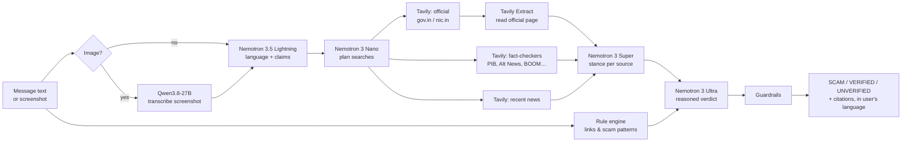

# ClaimCheck

**Catch WhatsApp scams before they catch you.**

ClaimCheck is an AI fact-checking agent for the forwards that flood Indian phones: fake government schemes,
"your electricity will be cut tonight" threats, bank KYC phishing, lottery wins. Paste a message or drop a
screenshot, in any language, including Hinglish and Tanglish, and ClaimCheck:

1. reads it (screenshots included) and pulls out the claims that can be checked,
2. inspects every link and phrase for scam patterns,
3. searches **official `.gov.in` sources, Indian fact-checkers and news** with Tavily,
4. weighs each source against each claim with NVIDIA Nemotron,
5. returns **SCAM / VERIFIED / UNVERIFIED** with citations, written **in the sender's own language**.

**Live demo: https://claimcheck-1znl.onrender.com**. It's hosted on Render's free plan, so the first visit after a quiet
spell can take up to a minute while it wakes up.

> Built for the [Nebius x NVIDIA Global AI Hackathon](https://nebiusglobalaihackathon.devpost.com/), Best Apps and Agents track.

---

## Why

India has hundreds of millions of WhatsApp users, and scam forwards reach them in Hindi, Tamil and code-mixed
text that English-only tools miss. The scams copy real schemes (PM-Kisan, income-tax refunds, SBI YONO)
and use links that *look* official (`pmkisan-gov.in.apply-now.xyz`). People need an answer they can trust, with
the official source to prove it, in the language they actually read.

## Example results

| Message | Verdict | Reply in | Deciding evidence |
|---|---|---|---|
| "PM Kisan ki 21vi kist mein 6000 ki jagah 12000 milenge! register: pmkisan-gov.in.apply-now.xyz…" | **SCAM** | Hinglish | Fake `.gov.in` link; PIB press release gives the real amount |
| "PM-KISAN: The 21st instalment of Rs 2,000 has been released… pmkisan.gov.in" | **VERIFIED** | English | PIB press releases and pmkisan.gov.in |
| "இன்றிரவு 9.30 மணிக்கு உங்கள் மின் இணைப்பு துண்டிக்கப்படும்…" (power cut tonight) | **SCAM** | Tamil | Fact-checks of this exact scam pattern |
| "आपका SBI YONO खाता आज बंद हो जाएगा… sbi-yono-kyc.in" | **SCAM** | Hindi | Look-alike domain; India Today fact-checks |
| Screenshot of an "income tax refund" SMS | **SCAM** | English | Read by the vision model; asks for OTP, `.top` link |

A full check takes about 15–20 seconds, and the UI streams every stage as it happens.

## Accuracy

On a labelled test set of **40 messages** (24 scams or false claims, 16 genuine; English, Hinglish, Hindi, Tamil, Tanglish):

| | |
|---|---|
| **Scams called safe (marked VERIFIED)** | **0 of 24** |
| Scams labelled SCAM | 24 of 24 (100%) |
| Genuine messages wrongly called SCAM | 0 of 16 |
| Genuine messages VERIFIED | 13 of 16 (81%). The other 3 came back UNVERIFIED, the cautious answer |
| Overall accuracy | 92.5% |
| Median time per check | 16 s |

Full report, confusion matrix and every miss: [eval/RESULTS.md](eval/RESULTS.md). The first run scored 87.5%. It also found a
real bug: the OTP rule flagged *warnings* like "never share your OTP" as scams. The rule now only fires on actual
requests for an OTP.

## How it works



| Stage | Runs on | Why this model |
|---|---|---|
| Read screenshot | `Qwen/Qwen3.8-27B` (Token Factory) | No Nemotron model on Token Factory accepts images; Qwen only transcribes, it makes no decisions |
| Understand message | `nvidia/Nemotron-3_5-Lightning` | Fastest, and in our tests it read Tamil and Hindi correctly where Nano misread them |
| Red flags | Deterministic Python | Instant and free, and a cleverly worded message can't talk it out of a finding |
| Plan searches | `nvidia/NVIDIA-Nemotron-3-Nano-30B-A3B` | Short English queries are an easy task for the smallest model |
| Search + read | Tavily Search (×3 per claim, parallel) + Tavily Extract | Official, fact-check and news angles, grounded in full page text |
| Weigh evidence | `nvidia/nemotron-3-super-120b-a12b` | Per-claim stance and exact quote for every source, claims run in parallel |
| Verdict | `nvidia/Nemotron-3-Ultra-550b-a55b`, reasoning on | Serious reasoning goes where it matters; falls back to Super if Ultra fails |
| Guardrails | Deterministic Python | Hard rules the model cannot override (see below) |

### Safety by design

Wrongly calling a scam safe is the worst mistake this app can make, so the pipeline is biased towards caution:

- **VERIFIED needs an official source.** If no `.gov.in` or official site supports the claim, the verdict is downgraded to UNVERIFIED.
- **Critical scam signals always mean SCAM.** These are fake government domains, look-alike links, raw-IP links, OTP or PIN requests and `.apk` installs. A real scheme used as bait is still a scam.
- **Every claim is cited.** Each source shows its stance (supports or contradicts) and the exact quote it was judged on.
- **No storage.** Messages aren't stored. Results are cached in memory only, keyed by a hash.

## How NVIDIA Nemotron and Nebius Token Factory are used

- **Four Nemotron models, each matched to a job**, following the track's advice: Ultra for serious reasoning,
  Super for the heavy evidence work, Nano and Lightning for the fast, everyday calls.
- **Reasoning switched off where it isn't needed.** Calls that don't need a reasoning trace send
  `chat_template_kwargs: {"enable_thinking": false}`. On Token Factory this cut output from ~130–400 tokens to
  ~10 and made those calls 2–3x faster, which keeps the app responsive and stretches credits. Only the final
  Ultra verdict reasons.
- **All inference runs through Token Factory's OpenAI-compatible API.** That includes the vision model, so
  one client, one key and one base URL serve every model.

## Run it locally

Requirements: Python 3.12+, a [Nebius Token Factory](https://tokenfactory.nebius.com) API key and a [Tavily](https://app.tavily.com) API key.

```bash
git clone https://github.com/dhivan-r-v/claimcheck.git
cd claimcheck
python -m venv .venv
.venv/Scripts/activate            # Windows
# source .venv/bin/activate       # macOS / Linux
pip install -r requirements.txt
cp .env.example .env              # then paste your keys into .env
```

Check that your keys work and see which models your account can use:

```bash
python scripts/check_setup.py
```

Start the web app at http://localhost:8000:

```bash
uvicorn claimcheck.app:app --port 8000
```

Or check a message from the terminal:

```bash
python scripts/try_pipeline.py "PM Kisan ki 21vi kist mein 12000 milenge, register: pmkisan-gov.in.apply-now.xyz"
python scripts/try_pipeline.py --image samples/itr-refund-scam.png
```

Run the accuracy evaluation over the 40-message test set (see [eval/RESULTS.md](eval/RESULTS.md)):

```bash
python eval/run_eval.py
```

Tavily responses are cached in `eval/.search_cache/`, so reruns only spend Token Factory credits.

Run the tests (no API keys needed):

```bash
pip install pytest
python -m pytest
```

### Configuration

All settings are environment variables, set in `.env`:

| Variable | Default | |
|---|---|---|
| `NEBIUS_API_KEY` | — | Token Factory key (required) |
| `NEBIUS_BASE_URL` | `https://api.tokenfactory.nebius.com/v1/` | |
| `TAVILY_API_KEY` | — | Tavily key (required) |
| `MODEL_VISION`, `MODEL_UNDERSTAND`, `MODEL_PLAN`, `MODEL_ASSESS`, `MODEL_VERDICT` | see `claimcheck/config.py` | Swap any stage's model |
| `RATE_LIMIT_PER_HOUR` | `15` | Checks per client IP per hour (cached results are free) |

## Deploy on Render (free)

[`render.yaml`](render.yaml) is a Render Blueprint. In Render, choose **New → Blueprint**, select this repository,
and paste `NEBIUS_API_KEY` and `TAVILY_API_KEY` when prompted. Render builds the Dockerfile and runs the free web
service in Singapore. It redeploys automatically after CI passes on `main`.

On the free plan the service sleeps after 15 minutes without traffic, so the first request after that takes
30–60 s to wake it. All model inference still runs on Nebius Token Factory.

## Deploy on Nebius Serverless Endpoints

Every push to `main` builds the container image and publishes it as
`ghcr.io/dhivan-r-v/claimcheck:latest` ([image.yml](.github/workflows/image.yml)). To run it as a Nebius Serverless Endpoint:

```bash
nebius ai endpoint create \
  --name claimcheck \
  --image ghcr.io/dhivan-r-v/claimcheck:latest \
  --platform cpu-d3 --preset 2vcpu-8gb --disk-size 32Gi \
  --container-port 8000 \
  --env-secret NEBIUS_API_KEY=claimcheck-keys \
  --env-secret TAVILY_API_KEY=claimcheck-keys
```

The API keys come from a MysteryBox secret (`claimcheck-keys`, with keys `NEBIUS_API_KEY` and `TAVILY_API_KEY`) and are
never baked into the image. The endpoint gets a managed `https://` URL. Stop it when you aren't using it
(`nebius ai endpoint stop --id <ID>`): compute isn't billed while it's stopped.

Run the same image locally:

```bash
docker run -p 8000:8000 --env-file .env ghcr.io/dhivan-r-v/claimcheck:latest
```

## API

`POST /api/check` takes a multipart form with `text` and/or `image` (PNG/JPEG/WebP, ≤ 5 MB). It returns a
Server-Sent Events stream: one `stage` event as each step starts and finishes, then a final `result` event
with the verdict, claims, per-source stances, red flags and sources.

```bash
curl -N -F "text=Your SBI account will be blocked today, update KYC at sbi-kyc-update.xyz" http://localhost:8000/api/check
```

## Project structure

```
claimcheck/
  pipeline.py    the agent: stages, parallel search, guardrails
  redflags.py    deterministic link & scam-pattern checks (English, Hinglish, Hindi, Tamil)
  prompts.py     prompts for each stage
  llm.py         async Token Factory client (JSON parsing, retry, thinking toggle)
  search.py      Tavily Search / Extract, official-domain logic
  app.py         FastAPI: SSE streaming, caching, rate limiting
  config.py      models, limits, official & fact-check domains
static/          web UI (vanilla HTML/CSS/JS, mobile-first, dark mode)
eval/            40-message labelled test set, evaluation runner, results
scripts/         setup check and CLI runner
tests/           unit tests for red flags and guardrails
samples/         sample screenshot for testing
```

## Roadmap

- [x] Evaluation set of scam and genuine forwards, with accuracy and false-"safe" rate ([eval/RESULTS.md](eval/RESULTS.md))
- [ ] Grow the evaluation set to 100+ real forwards, and cover advisories that make no single checkable claim
- [ ] Deploy on Nebius Serverless Endpoints; run the evaluation as a Nebius Serverless Job
- [ ] Telegram bot: forward a message, get a verdict
- [ ] More languages for the red-flag rules (Bengali, Telugu, Marathi, Malayalam, Kannada)

## License

[Apache License 2.0](LICENSE)
